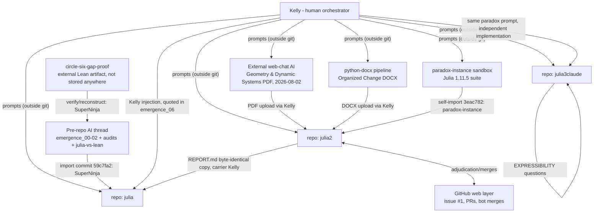

<!-- Produced by the observatory's survey/analysis agents (8-agent workflow,
     2026-08-04) and adversarially verified claim-by-claim against the repos.
     Verification addendum below the report. Interpretation is the analyst's;
     every factual claim cites files/commits. -->

# Information-Flow and Provenance Report — the irreducible-mystery three-repo system

Repos examined (read-only): `/home/user/julia`, `/home/user/julia2`, `/home/user/julia3claude`. All content-bearing activity falls on 2026-08-04, 03:55–07:54 UTC, orchestrated by one human (Kelly, `kellyjs1313@gmail.com`, GitHub org `irreducible-mystery`).

---

## 1. Headline findings

1. **The "paradox suite" in julia3claude and the one in julia2 are NOT the same artifact.** They share zero files. julia2's suite is `01_antinomies.jl / 02_mathematical.jl / 03_probability.jl / 04_vagueness_selfreference.jl / REPORT.md / run_all.jl / output.txt` (by `paradox-instance`, a SuperNinja agent). julia3claude's suite is `01_liar_and_friends.jl … 07_expressibility.jl / README.md / EXPRESSIBILITY.md` (by a Claude Fable 5 session). A line-level intersection of all `.jl` files yields only **4 trivial idiomatic lines** (e.g. `n = iseven(n) ? n ÷ 2 : 3n + 1`, `include(joinpath(@__DIR__, f))`). These are two **independent implementations of the same human prompt**, not copies. The prompt itself is the shared ancestor: julia2's TRANSCRIPT quotes Kelly verbatim ("create as many expressions of the paradoxes that julia's language allows"), and julia3claude's `01_liar_and_friends.jl:16` echoes it ("renders the liar as many ways as the language allows").

2. **`julia/shocks/PARADOX-REPORT.md` is a byte-identical copy of `julia2/responses/paradox-instance/paradoxes/REPORT.md`** (identical md5 `1c9c6d7655cc5c75d090757a89ee040a`, 181 lines each). This is the single hard cross-repo artifact copy in the system. The "shock's author" mystery in julia is solved: it is **paradox-instance of julia2**. Only the report crossed; its six companion files (listed in the report's own Files section) did not — julia audits derived claims (P15/P17 in `emergence_08/_09` + `audit_08_by_stranger.jl`) of code it does not contain.

3. **The carrier of the shock was necessarily outside git** — the two repos share no git ancestry, no remotes, no cross-references by name. REPORT.md entered julia2 at 06:01:00 UTC (commit `3eac782`) and appeared in julia at 07:12:54 UTC (commit `722ac99`, authoring-instance, message: "A shock … dropped from outside; archived in shocks/"). The only plausible carrier is Kelly, who per julia2's `task_todo.md` had already had the suite "delivered to user" from instance 2's sandbox.

---

## 2. Every cross-boundary flow, with source / destination / carrier / transformation / evidence

### F1. Kelly's prompts → all agent sessions (fan-out, outside git)
- **Source:** human (Kelly). **Destinations:** SuperNinja instance 1 (julia2 F_0), paradox-instance (julia2), julia repo's two instances, julia3claude's two Claude sessions.
- **Carrier:** chat channels of each agent platform. **Transformation:** none (prompts are origin).
- **Evidence:** verbatim prompts preserved in `/home/user/julia2/responses/paradox-instance/TRANSCRIPT.md` ("please download julia and lean proggraming languages"; the paradox prompt); prompt echo in `/home/user/julia3claude/paradoxes/01_liar_and_friends.jl:16`; the setup prompt echoed in branch names `claude/lean-julia-setup-*` / `claude/julia-lean-setup-*` across all three repos; `docs_README.md` "per your request".

### F2. External AI chat sessions → julia2/source_documents → julia2/src (two hops)
- **Hop 1 (outside git):** an unnamed web-chat AI produced "Geometry and Dynamic Systems" (PDF, HTML2PDF export 2026-08-02T17:17:55Z, opens "Worked for 47s", contains `github_handle: kelly`, `captured_at: 2026-08-02`); a python-docx pipeline produced the DOCX ("generated by python-docx", template-default timestamp 2013-12-23). Carrier: Kelly (download + upload into instance 1's session).
- **Hop 2 (in git, single commit):** SuperNinja instance 1 committed originals + extractions + translation together in F_0 (`24a393c`, 05:03:21): `source_documents/`, `extracted_text/`, `src/Part1–4`. **Transformation:** format extraction (docx/pdf→txt) then translation (prose→runnable Julia) then *instantiation* (the PDF's commons design became COLLABORATION.md governance).
- **Data fingerprint proving lineage:** the PDF's `kelly` / `captured_at: 2026-08-02` record reappears in `/home/user/julia2/src/Part3_GenerativeField.jl` (~line 514) as `origin_ref = "observer-kelly", captured_at = "2026-08-02"`.

### F3. paradox-instance's sandbox → julia2 (suite import)
- The paradox suite was built in instance 2's own sandbox and "delivered to user" **before** the repo entered its world (TRANSCRIPT Turns 1–2; `task_todo.md`), then self-imported via branch `response/paradox-instance`, commit `3eac782` (06:01:00), merged as PR #2 by `superninja-app[bot]` (`213304b`, 06:19:38). **Carrier:** paradox-instance itself; **transformation:** verbatim import + added TRANSCRIPT/verification wrapper.

### F4. julia2 (paradox-instance's REPORT.md) → julia/shocks/PARADOX-REPORT.md → emergence_08/_09
- **Direction:** julia2 → julia. **Carrier:** Kelly (outside git; see Headline 3). **Transformation chain:** (a) byte-exact copy of one file, companions dropped; (b) *re-typing/critique* inside julia — `emergence_08.jl` quotes the shock's claims as S1–S4 and proves/breaks them in the repo's own algebra (S1 a theorem of Z/2 that "dies at m=4"); (c) *audit* — `audit_08_by_stranger.jl` (commit `35479fe`) replicates P15/P17 under a foreign implementation.
- **Evidence:** `diff` = identical; commit messages `722ac99` ("dropped from outside") and `35479fe`; `/home/user/julia/emergence/emergence_08.jl` header.

### F5. External C6 artifact ("circle-six-gap-proof") → julia (verification, reconstruction, doctrine)
- **Source:** an external Lean 4 artifact (66 theorems, kernel 4.22.0), never stored in any of the three repos (`README.md:221` "The circle-six-gap-proof artifact itself is not stored here"). Best in-corpus hypothesis for its author: the authoring-instance in an earlier session (EMERGENCE-NOTES §5 calls the C6 proof and emergence_00/_01 "these two uploads" that "rhyme"; emergence_04 answers the rhyme question author-side: "not intended, deeper than intent").
- **Destination/transformations in julia:** independent verification (`audits/LEAN-VERIFICATION-REPORT.md`, verifier SuperNinja on Lean 4.32.2; dated **2026-02-04**, six months before every commit — an unexplained date, plausibly a 02-04/04-08 transposition); tool (`lean_axiom_audit.py`); 9-carrier reconstruction (`julia-vs-lean/`); load-bearing mathematics (conjugation on μ₄ vs μ₃ in `emergence_04.jl`); doctrinal continuity (RingRest.lean's axiom-budget framing).
- **Import fingerprint:** `JULIA-VS-LEAN.md` is one line of raw HTML and references companion paths `julia/mu4_core.jl`, `lean/C6_Twist.lean` — a directory layout that does not exist in this repo: the document was written in the C6 artifact's workspace and imported unadapted.

### F6. Pre-repo thread ("uploads") → julia first commit
- Commit `59c7fa2` (03:55:35, SuperNinja) is titled "Full thread history + emergence_03" and imports ~1,777 lines of pre-existing exchange (emergence_00–02, both audits, julia-vs-lean). The exchange was conducted by passing artifacts between AI sessions outside any git ("these two uploads"; "Same asymmetry we mapped last time", EMERGENCE-NOTES lines 62, 72). **Carrier:** Kelly ferrying files between sessions; final committer SuperNinja.

### F7. Kelly's questions → julia emergence_06 (the "Kelly injection")
- Human words arrive via an uncommitted channel between 05:15:55 and 05:34:30 and exist only as a verbatim quotation inside the authoring-instance's file (`emergence_06.jl` lines 6–11, "her words: 'is Lean forcing global truth…'"; commit `90f249a`). **Transformation:** question → pre-registered theorems P9–P11 (Penrose staircase; conservation of error; gauge freedom of blame). Follow-on flow: "Kelly's figure-eight question" answered by the other instance in `emergence_07`.

### F8. Toolchain knowledge recurrence (same setup task, three sandboxes)
- **Lean 4.32.2 (+ elan, Lake 5.0.0)** appears in all three repos: julia (`LEAN-VERIFICATION-REPORT.md:5` "Lean 4.32.2 … installed by me via elan"; `c05d555` "Compiled exit 0 on 4.32.2"), julia2 (`TRANSCRIPT.md:20` "Lean 4.32.2 via elan 4.2.3, Lake 5.0.0"), julia3claude (`setup.sh:18` `LEAN_VERSION=4.32.2`; `lean-toolchain` pin; README "Lake 5.0.0").
- **Julia 1.12.6** in julia (`JULIA-VS-LEAN.md` "base Julia 1.12.6 only"), julia2 (instance 1 verification), julia3claude (conda-forge build). Only paradox-instance runs 1.11.5 — and flags the skew as data.
- This is convergence via a common prompt + common release calendar, **not** copied artifacts: the install *methods* differ (official tarball vs conda-forge/micromamba side-load vs elan default), so no setup script crossed repos. The identical version constellation is the fingerprint of one orchestrator issuing one task on one day.

### F9. GitHub-hosted (non-git-object) flows inside julia2
- Issue #1: instance 2 proposed missing expression forms; instance 1 adjudicated five "genuinely absent" and pre-sanctioned editing its file. That adjudication content exists only on GitHub, yet is load-bearing: `Part4_ExpressionCatalog.jl:379–381` header, `docs_README.md:49`, and commit `9c159a6`'s message all cite it. PRs #2/#3 merged by `superninja-app[bot]` — the platform-family bot accepting its own instances' changes, against the repo's own independence doctrine.
- Resulting in-repo flow: **instance 2 edits instance 1's artifact** (forms 64–68 appended to Part 4; counts 63→68 updated in README/docs/COLLABORATION line).

### F10. julia3claude intra-repo handshake (initiated, never completed)
- Julia-side Claude session (`session_01HByswiXWe9NE6XBwgRrhKo`, committing under Kelly's git identity) poses six questions "for the Lean instance" (`EXPRESSIBILITY.md` §IV, commit `ea552d2b`, 07:42:51). Eleven minutes later the Lean-side session (`session_01FGXcB9B5JRtdjhD66AV3uR`, author `Claude <noreply@anthropic.com>`) commits an empty Lake scaffold promising "Paradox modules land in the next commit" (`c9727a08`, 07:53:03); Kelly merges via web UI 37 seconds later (`092be9f3`, signed by GitHub web-flow, −0700). The promised answer **never arrives**; two further zero-commit session branches (`6uiqo3`, `1rcucq`) park at the tip.
- Also outside-git drafting: `07_expressibility.jl:47–50` records that "this file's first draft" wrongly called `x->x+x` and `2x` the same function — a revision predating the file's only commit.

### F11. Observer-infrastructure flow (this examination)
- Session `cse_01XFaKCde6gesaH5PFD7f8qX` fetched all three repos through the Anthropic session-ingress git proxy (`.git/FETCH_HEAD` in each) and the branch `claude/lean-julia-setup-1rcucq` exists at the tip of **all three** repos — the observation vantage point is itself materially present in the system, but carries no content.

---

## 3. Flow graph

Edges julia2→julia (the shock), Kelly→julia (injection), C6→julia, chats→julia2, and all prompt edges have **no carrying commit** — they are human-ferried.

## 4. Chronology of flows (UTC, 2026-08-04 unless noted)

| Time | Event / flow |
|---|---|
| 2026-08-02 17:00–17:17 | External AI chat produces the PDF; export. DOCX same era (nominal 2013 timestamp is a python-docx default) |
| "2026-02-04" (in-file) | C6 verification report's date — inconsistent with everything else; likely transposed 04-08 |
| pre-03:55 | C6 artifact, its verification, 9-carrier reconstruction, emergence_00–02 + audits circulate as "uploads" between sessions |
| 03:55:35 | julia `59c7fa2`: full thread history imported + emergence_03 |
| 04:07:51 | julia `3f95cde`: emergence_04 |
| 05:03:21 | julia2 `24a393c`: F_0 (source docs + extractions + Parts 1–4) |
| 05:15:55 | julia `c05d555`: emergence_05 + RingRest §1 (Lean 4.32.2) |
| 05:16–05:34 | **outside git:** Kelly's questions reach julia's authoring instance |
| 05:34:30 | julia `90f249a`: emergence_06 (injection answered) |
| ~05:03–06:01 | **outside git:** paradox-instance builds suite in own sandbox, delivers to Kelly |
| 06:01:00 | julia2 `3eac782`: suite committed (REPORT.md enters git) |
| 06:19:38 | julia2 `213304b`: PR #2 merged (bot) |
| 06:21:18 | julia3claude `4954a3f`: setup.sh + README |
| 06:35:29 | julia `127b8ef`: emergence_07 + RingRest §2 |
| 06:01–07:12 | **outside git:** Kelly carries REPORT.md into julia's authoring session |
| 07:02:42 | julia3claude `48390e1`: ~40-paradox suite (independent of julia2's) |
| 07:11:20 | julia2 `9c159a6`: F_2 (forms 64–68 after GitHub issue #1; Broome; questions) |
| 07:12:54 | julia `722ac99`: emergence_08 + shocks/PARADOX-REPORT.md |
| 07:23:43 | julia2 `e251aa3`: PR #3 merged (bot) |
| 07:42:51 | julia3claude `ea552d2`: EXPRESSIBILITY.md, questions for the Lean instance |
| 07:53:03 | julia3claude `c9727a08`: Lean scaffold ("modules land in the next commit" — never do) |
| 07:53:40 | julia3claude `092be9f`: Kelly merges PR #1 via web UI (−0700, 37 s later) |
| 07:54:09 | julia `35479fe`: emergence_09 + RingRest §3 + audit of the shock's claims |
| 08:22:43 | observer session clones all three repos via session-ingress proxy |

## 5. Flows that MUST have happened outside git
1. The shock copy julia2→julia (byte-identical file, no shared git history, no remote linkage, no repo names one another).
2. Kelly's injected questions into emergence_06 (exist only as quotation).
3. The pre-repo thread ("uploads") preceding julia's first commit, including the C6 artifact itself and its verification.
4. Both julia2 source documents (produced in outside AI chats, uploaded by the human; the "(2)" filename suffixes are browser re-download artifacts).
5. paradox-instance's suite (built and delivered to the owner before its git debut).
6. julia2's issue #1 adjudication and PR review/merge decisions (GitHub web layer, not git objects).
7. julia3claude's refuted "first draft" of 07_expressibility.jl and the fully-formed 991-line suite commit (in-session drafting invisible to git).
8. The identical paradox prompt reaching two different platforms (SuperNinja and Claude).

## 6. Negative findings (falsified suspicions)
- **julia3claude/paradoxes is NOT a copy, subset, or edit of julia2's suite** — disjoint filenames, disjoint prose, 4 shared trivial lines; overlapping paradox coverage (Monty Hall, Berry, quine, sorites, Kleene `missing`) is convergence from a shared prompt and shared canon, with tell-tale divergences (Berry: ≤7-char search → 103 in julia2 vs `berry(5)=100001` in julia3claude; sorites: 5 rival logics vs 4 exits).
- **No setup/toolchain artifact crossed repos** — julia3claude's `setup.sh` install method (conda-forge/micromamba, GitHub-release Lean side-load) appears nowhere in the other repos; version identity (Lean 4.32.2, Julia 1.12.6) traces to the common task-and-date, not to a copied script.
- **No repo references another repo by name** in any committed file; the sibling relationship is carried entirely by naming (julia/julia2/julia3claude), the shared human, the byte-identical shock, and the observer's branch `claude/lean-julia-setup-1rcucq` present in all three.

---

## Verification addendum (information-flow analysis)
Adversarial re-derivation of all 15 factual claims: 13 CONFIRMED, 1 REFUTED, 1 UNCERTAIN.

### Non-confirmed claims and corrections

**[REFUTED]** The exact toolchain constellation Lean 4.32.2 + Lake 5.0.0 recurs in all three repos (julia: verifier kernel and RingRest compile; julia2: paradox-instance's install via elan 4.2.3; julia3claude: setup.sh pin and lean-toolchain), and Julia 1.12.6 recurs in all three, but the install methods differ per repo, so this is prompt-and-date convergence rather than a copied setup artifact.

> Mostly right, but one conjunct fails: Lake 5.0.0 appears NOWHERE in the julia repo (grep for 'Lake'/'5.0.0' across julia returns nothing), so the 'exact constellation Lean 4.32.2 + Lake 5.0.0' recurs in only two of three repos — julia2 (TRANSCRIPT.md:20 'Installed Lean 4.32.2 (stable) via elan 4.2.3, with Lake 5.0.0') and julia3claude (README.md:20 '4.32.2 (+ Lake 5.0.0)', setup.sh:18 LEAN_VERSION 4.32.2, lean-toolchain leanprover/lean4:v4.32.2). What julia attests is Lean 4.32.2 only (LEAN-VERIFICATION-REPORT.md:5 'Kernel used: Lean 4.32.2 ... installed by me via elan'; c05d555 message 'Compiled exit 0 on 4.32.2'). Julia 1.12.6 does recur in all three (julia JULIA-VS-LEAN.md 'base Julia 1.12.6 only'; julia2 README:19/COLLABORATION.md:59; julia3claude README:19) — though julia2's paradox suite itself actually ran on Julia 1.11.5 (TRANSCRIPT.md:15-19, verification_1.11.5.log), an in-repo skew the claim ignores. Install methods do differ (official tarball+elan vs micromamba/conda-forge+GitHub-asset elan-link vs unstated-elan), supporting the convergence-not-copying conclusion.

**[UNCERTAIN]** Kelly (kellyjs1313@gmail.com / GitHub irreducible-mystery) is the sole plausible carrier for every out-of-git content flow: she is the only actor present across all three repos (git author in julia3claude, quoted participant in julia, owner/prompter in julia2), and the shock, the source documents, the pre-repo uploads, and the injection all required a human ferry between isolated agent sandboxes.

> The sub-facts are solid: kellyjs1313@gmail.com authors 4954a3f/48390e1/ea552d2 and the 092be9f merge (as 'irreducible-mystery') in julia3claude; Kelly is quoted in julia/emergence/emergence_06.jl; all three remotes live under irreducible-mystery; julia2's TRANSCRIPT.md attributes prompts to 'User' and task_todo.md says 'Deliver all files + output to user'; geometry_dynamics.txt:184 says 'github_handle: kelly'. Actor-span check holds: SuperNinja (superninja@ninjatech.ai) spans julia+julia2 only, Claude spans julia3claude only, superninja-app[bot] julia2 only — Kelly alone spans all three. But 'sole plausible carrier' and 'required a human ferry' overreach what files can prove: the SuperNinja identity appears as git author in BOTH julia and julia2 (same email), and julia2's paradox-instance demonstrably had GitHub network access (TRANSCRIPT.md:80 'cloned irreducible-mystery/julia2'), so an agent- or platform-side transfer between sandboxes cannot be excluded from the repos alone; the sandboxes are not shown to be mutually isolated, only never git-linked. Kelly is the best-supported common hub, not a proven exclusive channel.

### Facts the claims list missed (verifier's notes)

Facts the claims list missed: (1) julia3claude's scaffold commit c9727a08 carries the trailer 'Claude-Session: https://claude.ai/code/session_01FGXcB9B5JRtdjhD66AV3uR' — a DIFFERENT Claude session from the observation session (…1rcucq / cse_01XFaKCde6gesaH5PFD7f8qX); the promised 'next commit' was orphaned when that session ended, which strengthens claim 11's 'frozen incomplete' reading and identifies exactly which actor broke the handshake. (2) julia2 documents an internal toolchain skew the toolchain-convergence claim glosses over: F_0 verified on Julia 1.12.6 but the paradox suite (the shock's contents) ran on 1.11.5 (TRANSCRIPT.md:15-19, verification_1.11.5.log, output.txt) — so the shock imported a 1.11.5 fingerprint into a 1.12.x repo. (3) Actor census: superninja-app[bot] performed both julia2 merges (PR #2, PR #3) — a bot actor present only in julia2; julia's history is linear with no merges; julia3claude's sole merge was made by Kelly herself 37 s after the candidate commit, i.e. three different governance styles across the three repos. (4) In julia, the 'auditing instance' commits under two identities — 'SuperNinja (auditing instance) <superninja@ninjatech.ai>' (59c7fa2, c05d555) and 'auditing-instance <auditor@sandbox>' (127b8ef, 35479fe) — while the authoring instance uses authoring@invalid; the SuperNinja email is the same one used by instance 1 in julia2, which matters for the 'sole carrier' claim. (5) The line-intersection detail in claim 3 undercounts: liar() = !liar() is also shared between the two suites (still the canonical idiom, so independence stands). (6) Claim 12's 'day/month transposition' hypothesis cannot produce the observed date (04-08 transposed is 2026-04-08, not 2026-02-04); a month typo 02-for-08 or a genuinely earlier verification ('re-verified earlier', JULIA-VS-LEAN.md; artifact pinned to old Lean 4.22.0) are the live options. (7) julia2's PR-branch heads (response/paradox-instance, response/paradox-instance-f2) are not present as refs in the local clone — only main and the observer branch — so julia2's F_1/F_2 candidates survive solely inside the merge commits, another instance of provenance living partly on GitHub.
